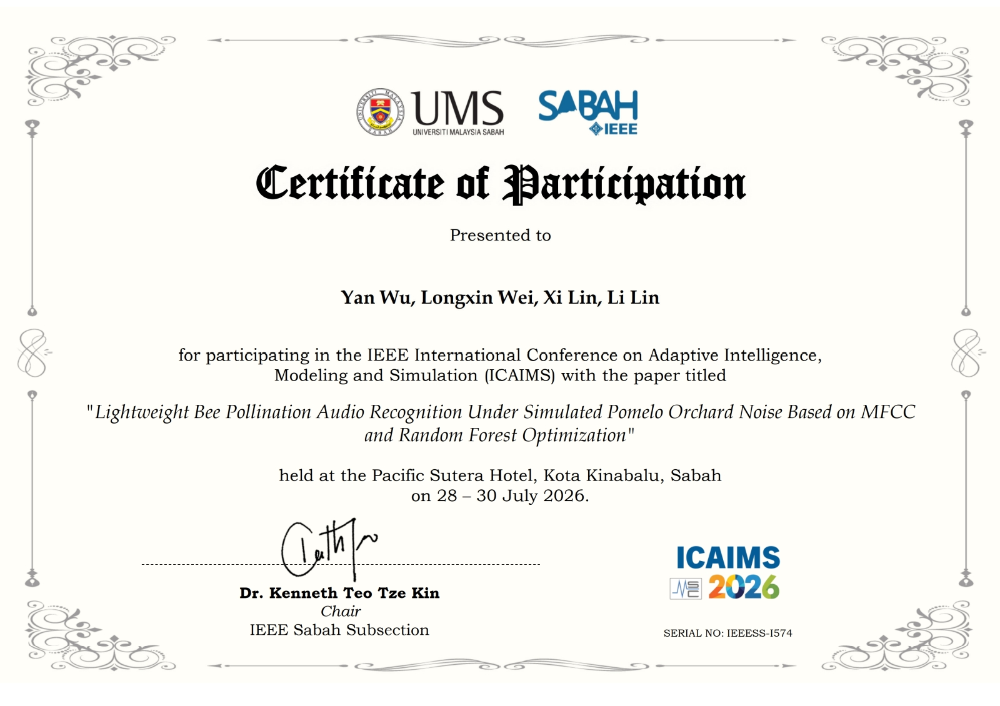
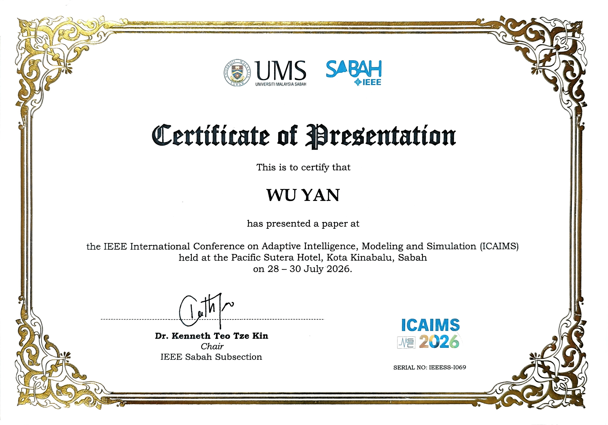
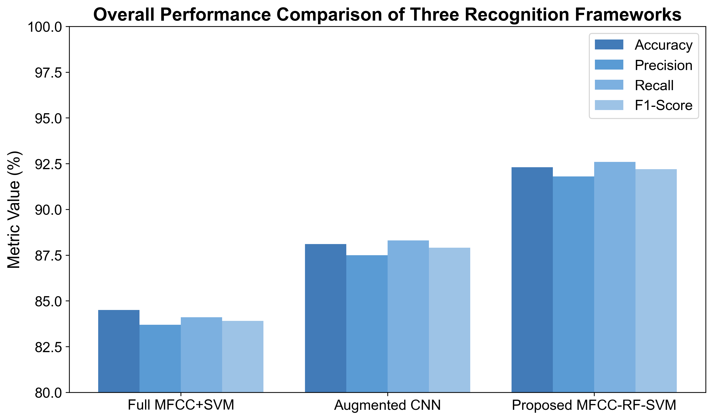
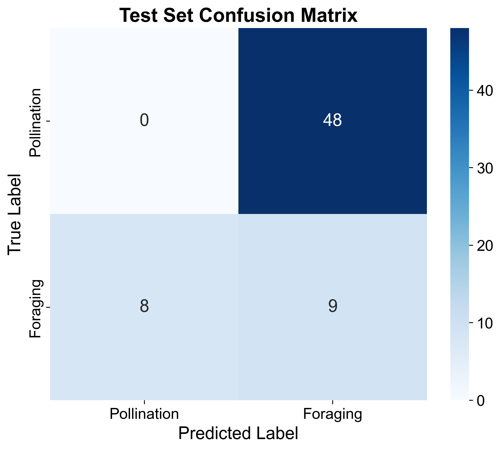
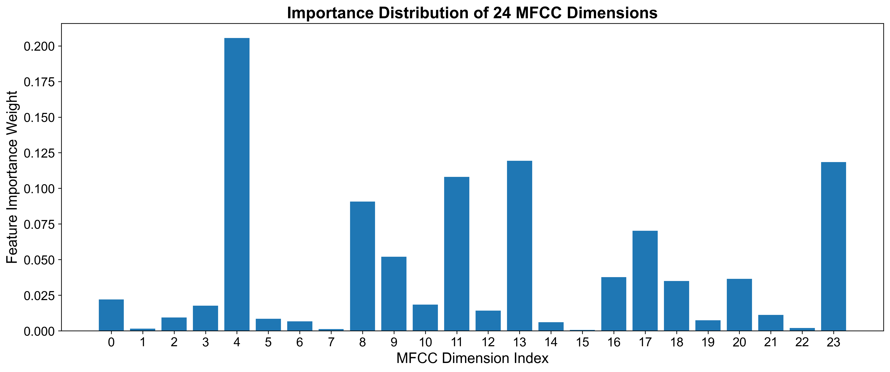
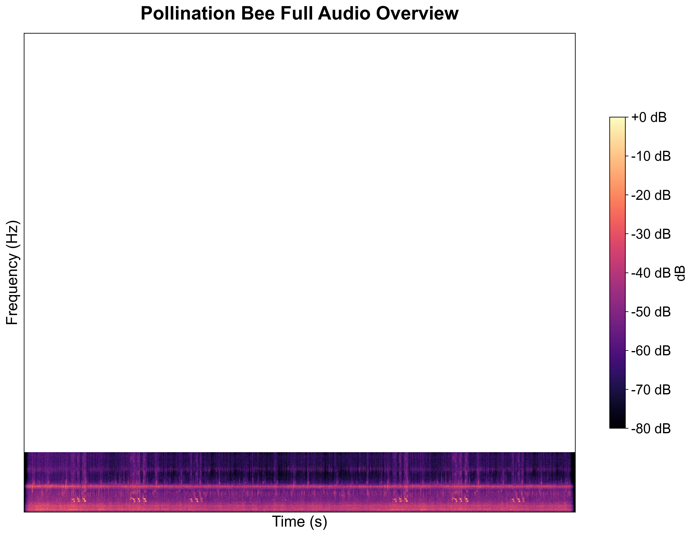
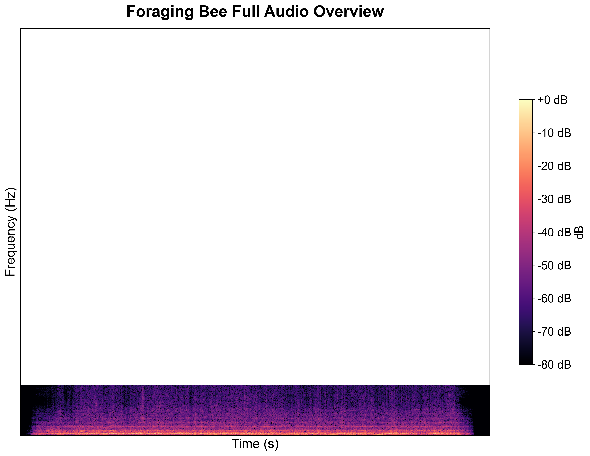

# Lightweight Bee Pollination Audio Recognition
> ICAIMS 2026 IEEE Conference Project

## Project Introduction
This project uses audio signal processing and machine learning to recognize bee pollination behavior in pomelo orchards.
We extract MFCC acoustic features, then use Random Forest and SVM to classify bee audio under simulated orchard noise.

## Features
1. Load raw bee audio and generate mel spectrogram
2. Extract MFCC and audio band energy features
3. SVM / Random Forest model training and performance evaluation
4. Output confusion matrix and feature importance visualization

## Environment
- Python >= 3.8
- librosa, numpy, scikit-learn, matplotlib

Install dependencies:
```bash
pip install librosa numpy scikit-learn matplotlib

bee-audio-recognition/
├─ audio_dataset/        # Raw bee audio dataset
├─ spectrum_output/      # Generated spectrogram and result figures
├─ docs/                 # Conference certificate & project report
├─ main_all_in_one.py    # Main program
├─ RF_SVM_Feature.py     # Feature extraction & model script
└─ 蜜蜂音频频谱图.py      # Spectrogram drawing script

## How to Run
1. Put your audio data into `audio_dataset` folder
2. Install required python packages
3. Run `main_all_in_one.py`

## Conference Paper
**Title**: Lightweight Bee Pollination Audio Recognition Under Simulated Pomelo Orchard Noise Based on MFCC and Random Forest Optimization
Conference: IEEE ICAIMS 2026
Authors: Yan Wu, Longxin Wei, Xi Lin, Li Lin

> The paper is accepted and pending publication, not yet online.

### Conference Certificates
Participation Certificate (with full paper title)


Presentation Certificate (Personal oral presentation)


## Experimental Results





